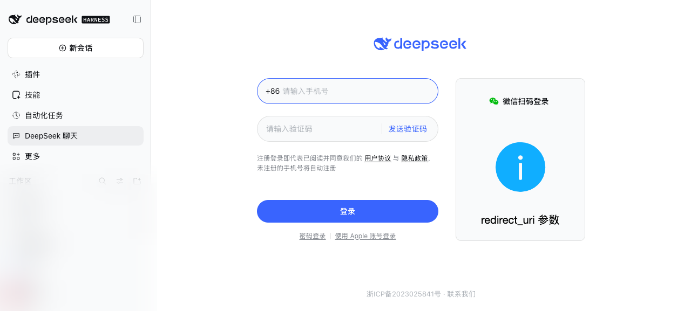

# dsh-deepseek-chat

在 DSH 左侧导航栏打开 [chat.deepseek.com](https://chat.deepseek.com/)，登录状态跨 DSH 重启保留。

An unofficial DSH plugin that embeds chat.deepseek.com in the left navigation, with a login that survives restarts.



> 非官方插件，与 DeepSeek 官方无关。使用自己的账号登录，Cookie 只保存在本机。

## 功能

- 左侧导航新增「DeepSeek 聊天」，点击后主内容区整块显示 chat.deepseek.com（没有额外的标题栏或按钮）；
- 登录一次即可，**重启 DSH 后仍然保持登录**；
- 支持手机号 / 邮箱登录，SSE 流式回复、文件上传下载、页面内深色主题都照常工作；
- Web profile 和桌面版都可以用；
- 不需要改 DSH 源码，作为一个普通 profile 插件安装 / 卸载。

## 为什么需要本地反向代理

`chat.deepseek.com` 不是一个能直接 iframe 的站点：

| 障碍 | 处理方式 |
| --- | --- |
| `Content-Security-Policy: frame-ancestors 'none'` | Host 半边在 `127.0.0.1` 起反向代理，只裁掉 `frame-ancestors` 这一条 CSP 指令和 `X-Frame-Options` |
| 登录 Cookie 是 `Secure; HttpOnly; SameSite=Strict` | Cookie 不进浏览器，由插件自己的**服务端 jar** 持久化到 `~/.dsh/deepseek-chat/cookies.json`（0600） |
| 登录 token 存在 `localStorage` | 代理端口固定，iframe 的 origin 稳定，`localStorage` 跟着保留 |
| 静态资源 CDN 的 CORS 只认 `chat.deepseek.com` | 重写 HTML，去掉脚本/样式上的 `crossorigin` 与 `integrity`（普通跨域脚本不需要 CORS） |
| 前端检测 Electron UA 会弹「使用环境异常」 | 注入环境垫片隐藏 Electron 标记，并清洗发给上游的 `User-Agent` |

结构：

```
左侧导航「DeepSeek 聊天」          ← client half（slot: sidebar.panellist）
        │
        ▼
主内容区全宽页面（slot: main）
        │  iframe
        ▼
http://127.0.0.1:45917/            ← host half 的本地反代
        │  cookie jar + HTML/UA 重写
        ▼
https://chat.deepseek.com
```

## 环境要求

- DSH `0.2.x`（在 `0.2.1-rc.5` 上开发与验证）；
- Node.js ≥ 20；
- profile 里包含 `@deepseek-ai/dsh-client-ui-sidebar` 与 `dsh-client-ui-layout`（默认的 web / desktop 组合都有）。

## 安装

### 方式 A：DSH 插件页安装（推荐）

1. 打开 DSH，左侧边栏 → **插件** → **添加插件** → **安装第三方插件**；
2. 填本仓库地址（`https://github.com/minorsnownight/dsh-deepseek-chat`）或本机克隆目录的绝对路径；
3. 安装完成后会出现在「已安装插件」里，可以随时启用 / 禁用 / 卸载；
4. 若安装后左侧导航没出现入口，重启一次 DSH。

### 方式 B：CLI 安装

用于非 Electron 托管的 profile：

```sh
dsh plugin --profile web add github:minorsnownight/dsh-deepseek-chat
```

> `desktop` profile 由桌面应用独占，CLI 会拒绝直接操作；请用方式 A，或按下文「本地开发」手动挂载。

### 方式 C：本地开发（link 安装）

```sh
git clone https://github.com/minorsnownight/dsh-deepseek-chat.git ~/code/dsh-deepseek-chat
cd ~/.dsh/profiles/desktop
pnpm add link:$HOME/code/dsh-deepseek-chat
# 再把 "dsh-deepseek-chat" 追加到 package.json 的 dsh.profile.bundles 数组
pnpm install
```

之后重启 DSH。`link:` 方式下，改 `lib/client.js` 刷新页面即可生效，改 Host 代码需要重启。

## 使用

- 左侧导航点 **DeepSeek 聊天**；
- 在页面里正常登录一次；
- 页面没有额外交互控件：返回会话点左侧的会话列表即可；
- 退出登录：用 DeepSeek 页面自己的账号菜单；需要强制清理时删除 `~/.dsh/deepseek-chat/cookies.json` 并刷新。

## 配置（可选）

在 profile 的 patch 层里给这个插件行加 `config`：

```yaml
- insert:
    - id: deepseek-chat
      name: 'dsh-deepseek-chat'
      config:
        port: 45917            # 首选端口；被占用时自动尝试 45918/45919/45920/随机
        host: 127.0.0.1        # 只支持回环地址
        upstream: 'https://chat.deepseek.com'
        # dataDir: '/home/you/.dsh/deepseek-chat'   # 默认 $DSH_HOME/deepseek-chat，不做 ~ 展开
```

`port` 尽量固定：代理 origin 变了，页面 `localStorage` 就是新的一份（jar 里的 Cookie 仍在）。

## 已知限制

- **微信扫码登录**：代理 origin 不在微信开放平台白名单里，二维码区域可能显示 `redirect_uri 参数错误`；手机号 / 邮箱登录正常。
- **第三方 OAuth**：Google / Apple 登录会跳到对方域名，对方的 `frame-ancestors` 会拦住，无法在 iframe 内完成。
- **只监听回环**：代理只绑定 `127.0.0.1`，且拒绝带外部 `Origin` 的请求；同机其它进程仍可访问该端口，请把它当作本机工具看待。
- **站点风控**：DeepSeek 前置 WAF 会拒绝明显不是浏览器的请求（默认 UA 的 `curl` 会得到 429）；插件透传浏览器 UA 并去掉 Electron 标记。
- **端口被占用**：会退到备用端口，功能不受影响，但页面 `localStorage` 会换一份。
- **平台验证**：只在 macOS + DSH `0.2.1-rc.5` 上实测过；Windows / Linux 的代码路径相同，但未实测。

## 排错

- 页面一直停在「正在启动本地代理…」：看 Host 日志里有没有 `[dsh-deepseek-chat] proxy listening at ...`；没有的话检查端口占用与 `dataDir` 是否可写。
- 页面显示 DeepSeek 的「页面资源加载异常」：说明上游 HTML 没被重写（`crossorigin` 仍在）。确认运行的是最新版 Host 代码。
- 重启后变成未登录：确认 `~/.dsh/deepseek-chat/cookies.json` 里的 Cookie 还在、代理端口是否还是同一个。
- 左侧导航没有入口：确认插件在「插件」页处于启用状态；Client bundle 改动后刷新页面（桌面版 `Cmd/Ctrl+R`）。

## 开发

没有运行时依赖，测试直接跑 Node 自带的 test runner：

```sh
npm test
```

结构：

```
lib/index.js          Host 半边：代理生命周期 + /deepseek-chat/status 路由
lib/proxy.js          反向代理：CSP 裁剪、HTML/UA 重写、Cookie 注入、SSE / 下载透传
lib/jar.js            落盘 Cookie jar
lib/client.js         Client 半边：左侧导航项 + main 全宽页面（手写 module-loader bundle，无构建步骤）
cordis.patch.yml      作为 bundle 安装时挂载 Host 行
test/plugin.test.js   单元测试
```

调试：

- Host 日志前缀 `[dsh-deepseek-chat]`；
- Cookie jar：`~/.dsh/deepseek-chat/cookies.json`；
- 状态接口：`GET http://127.0.0.1:<dsh-port>/deepseek-chat/status`。

## License

[MIT](LICENSE)

> npm 上已有另一个同名包（`dsh-deepseek-chat`，作者与功能都不同）。本仓库没有发布到 npm，安装请使用上面的 GitHub 源。
